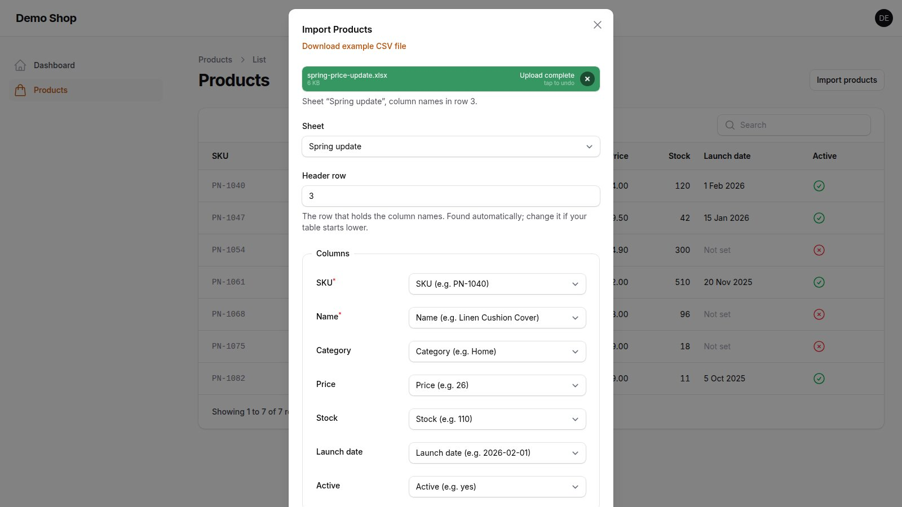
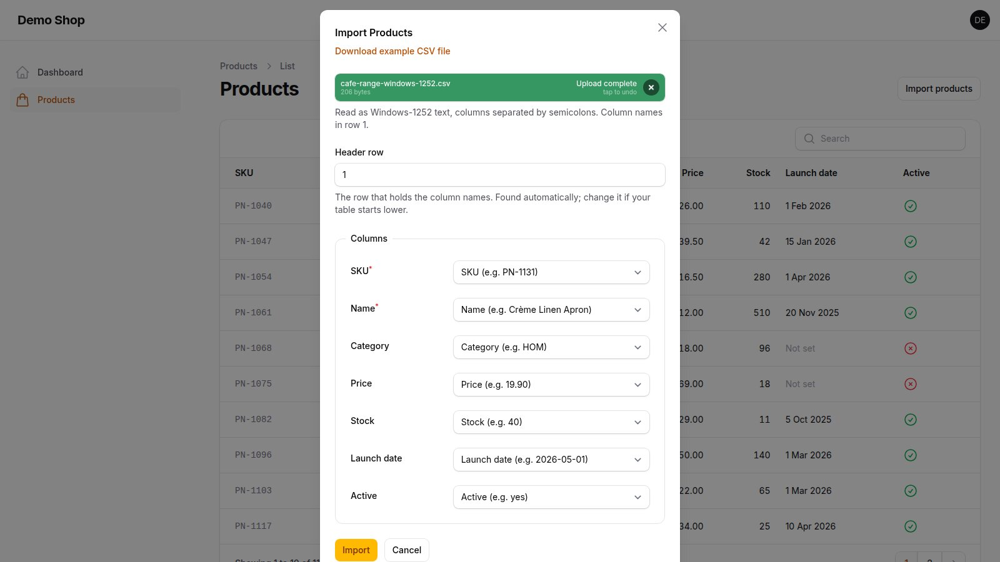
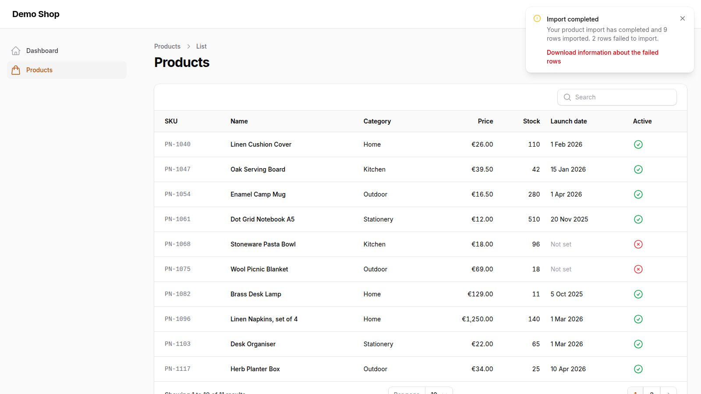
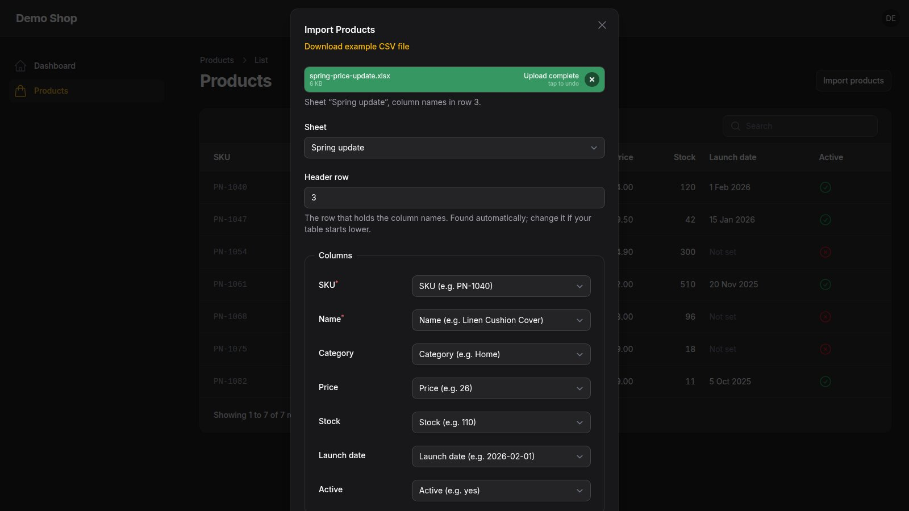

# Sheafgate Lite by PN Scripts

**Messy spreadsheets into Filament 5's own importer.** A drop-in replacement for Filament's `ImportAction` that reads XLSX, ODS and CSV files the way they arrive from suppliers and old systems: CSV in any common encoding and delimiter, a title or notes above the header row, merged and blank header cells, several sheets. Filament's column mapping, validation, queued chunks, notifications and failed-rows download work exactly as before. Filament 5 only.



What it adds to Filament's CSV-only import:

- **CSV that just works:** UTF-8 (with or without BOM), UTF-16 (Excel's "Unicode text"), Windows-1251 and Windows-1252 are detected, as are comma, semicolon, tab and vertical-bar separators. Filament's own detection never reaches Windows-1251/1252 or UTF-16.
- **The header row is found** below title rows and notes, and people can correct it in the modal.
- **Merged, blank and duplicate header cells** get usable names ("Size", "Size (2)", "Column C").
- **ODS read by its own streaming reader,** which keeps merged cells in their columns and reads `false` as false (common PHP readers shift columns after merged ODS cells).
- **Example values in the mapping:** "Price (e.g. 19.9)".
- **Safe limits:** 50 000 data rows by default and a check of the unpacked size before a workbook is parsed.

Other packages also read XLSX into Filament's importer; Sheafgate Lite is the one built for files that are not tidy.

## Quick start

1. Install the package:

   ```bash
   composer require pnscripts/sheafgate-lite
   ```

2. Use Sheafgate's action instead of Filament's, with the importer you already have:

   ```php
   use PNScripts\SheafgateLite\ImportAction; // was: use Filament\Actions\ImportAction;

   protected function getHeaderActions(): array
   {
       return [
           ImportAction::make()->importer(ProductImporter::class),
       ];
   }
   ```

3. Click **Import products** and upload an `.xlsx`, `.ods` or `.csv` file.

Installing from the release archive instead of Packagist: unzip it to `packages/filament-sheafgate-lite`, then

```bash
composer config repositories.sheafgate-lite '{"type": "path", "url": "packages/filament-sheafgate-lite", "options": {"versions": {"pnscripts/sheafgate-lite": "1.0.1"}}}'
composer require pnscripts/sheafgate-lite:^1.0
```

If you have not used Filament's importer yet, follow Filament's [import action guide](https://filamentphp.com/docs/5.x/actions/import) first (an importer class and the `imports`, `failed_import_rows` and `job_batches` tables). There is nothing else to publish or register.

## What it does

| | |
|---|---|
|  |  |
| CSV in UTF-8, UTF-16, Windows-1251 or Windows-1252, with commas, semicolons, tabs or vertical bars: detected and shown. | Filament's own import runs: chunks, notifications and the failed-rows file. Values are imported as Filament reads them: the “12,50” of the demo file became 1,250.00 (see Not included). |

- **Workbooks:** `.xlsx` (Excel, LibreOffice, Google Sheets exports) and `.ods`. When a workbook has several sheets, a **Sheet** field appears; the first sheet with data is chosen.
- **Header row found for you:** title rows, notes and blank rows above the table are skipped; the **Header row** field lets people correct it.
- **Messy headers handled:** blank header cells become "Column C", merged cells "Size", "Size (2)", duplicates are numbered, line breaks inside names are folded. Filament would refuse duplicate or blank headers.
- **Values read faithfully:** dates and date-times (Excel's 1900 and 1904 date systems) as `2026-03-01` and `2026-03-01 14:30:00`, times as `09:30:00`, booleans as `1`/`0`, formulas as their saved result, numbers without float noise or E notation (`0.1 + 0.2` is `0.3`, a 20-digit number is not `1.2E+19`), text cells exactly as typed (`00123`). A number shown with leading zeros only by its format (`00022`) arrives as `22`: store such codes as text.
- **No silent zeros:** a formula saved without a result (files written by libraries) or an error cell such as `#DIV/0!` stops the import with the cell named, instead of importing 0 or nothing.
- **Mapping with examples:** each file column in the mapping shows its first value, for example "Price (e.g. 19.9)".
- **Clear errors:** old `.xls` files ("save it as .xlsx"), damaged workbooks, ZIP files that are not workbooks and empty sheets are refused with a message instead of a stack trace.
- **Everything else is Filament's:** `maxRows()`, `chunkSize()`, `options()`, `job()`, the example CSV, `authorize()`, the completion notification and the failed-rows download behave as documented by Filament.
- **English and Bulgarian** included.



## Requirements

- PHP 8.2 or newer
- Laravel 12 or 13
- Filament 5.8 or newer
- For XLSX and ODS: PHP may start a process (`proc_open` enabled) and a PHP command-line binary is available (found next to the running PHP; set `SHEAFGATE_PHP_BINARY` or `reader.php_binary` in `config/sheafgate-lite.php` under PHP-FPM if it is elsewhere). Without them XLSX and ODS uploads are refused with a clear message and CSV files still work. The `posix` extension (standard on Linux) lets the reader cap its own memory.

Tested with the full test suite (203 tests) on:

| PHP | Laravel | Filament | Livewire | OpenSpout |
|---|---|---|---|---|
| 8.4.27 | 13.40.0 | 5.11.1 | 4.4.8 | 4.32.0 |
| 8.2.35 | 12.71.0 | 5.8.4 | 4.4.8 | 4.28.5 |

The release archive was installed in fresh Laravel apps (Laravel 13 with Filament 5.11 on PHP 8.4, and Laravel 12 with Filament 5.8 on PHP 8.2) and the flow above passed in headless Chrome. The screenshots come from that app.

## Usage

### Options

```php
ImportAction::make()
    ->importer(ProductImporter::class)
    ->headerOffset(2)              // the header is in row 3 (otherwise it is found automatically)
    ->headerRowField(false)        // hide the "Header row" field
    ->csvEncoding('Windows-1251')  // when you know it (otherwise detected)
    ->csvDelimiter(';')            // when you know it (otherwise detected)
```

`ImportAction` extends Filament's `ImportAction`; every Filament option keeps working. The sheet and header row chosen in the modal reach your importer in `$this->options['sheafgate']`.

### How values arrive in your importer

Filament importers receive text. Sheafgate Lite writes cells the way a person reads them: numbers with a dot as the decimal separator and at most 15 significant digits (as spreadsheets show them), percentages as fractions (`15 %` is `0.15`), booleans as `1` and `0`, which `ImportColumn::boolean()` and integer columns both accept. Text cells are passed exactly as written. Cells to the right of the last header are ignored.

### Limits

Measured on the build machine (4 cores, busy with other builds, PHP 8.4) with a 1.7 MB LibreOffice XLSX of 40,000 rows and 7 columns, `php tools/benchmark.php <file>`:

| Step | Time |
|---|---|
| Upload: archive check, sheet list, header row, mapping examples (first request) | 0.6 to 0.8 s |
| The same file on later requests (cached per upload) | under 0.01 s |
| Reading all 40,000 rows | 2.2 to 5.3 s |

Filament's import then runs in queued chunks. Hostile files (lying archive sizes, huge shared strings, one huge cell, rows padded to column XFD, rows of a million cells) are refused in 0.1 to 1.4 s.

Reading stops with a clear message after 50 000 data rows, or one row past `maxRows()` when you set it (Filament then refuses the file with its own message). Every part of a workbook is unpacked once before it is parsed and the bytes it really produces are counted (the sizes an archive states can be false): a part may unpack to 10 MB, or to 100 times its packed size when larger, and the whole workbook to 256 MB. Cells over 32,767 characters (the spreadsheet maximum) and broken XML give a clear message, never an error page.

Further caps, so a 128 MB `memory_limit` is enough for any file that passes them: at most 5,000 parts in an archive (checked on its directory first), every part unpacked once and measured whatever its name (a relationship can point the reader at any part), at most 1,000 sheets, workbook and relationship parts up to 4 MB, at most 100,000 cell and number formats, libxml's nesting limit of 256 levels kept, cells only up to the last spreadsheet column XFD and row 1,048,576, at most 16,384 cells in one row (CSV: fields in one line), and at most 2 million shared strings or 32 MB of shared text, kept packed in one string and read only as far as the rows need them. Every row the file holds counts toward the row limit, also one whose values all lie right of the header, and cells right of the header are skipped, never stored. Rows are never padded to a whitespace-only far cell, the preview stops after 1,000 whitespace-only rows, every row element (empty ones included) counts toward one budget of 2,097,152 per upload request and every cell element (empty ones included) toward one of 4,000,000 (a 50,000-row sheet of 80 columns), several sheets pointing at one part are read once, an ODS space run is clamped to the cell limit, and CSV blank lines count toward the scanned rows and CSV cells have the same 32,767-character limit. Hostile files that took 25 s to over 200 s before these caps (a million rows with one value in column XFD, a row of a million cells, an ODS row padded to XFD, 5 million shared strings) are refused or read in 0.1 to 1 s; a CSV line of a million fields is refused in about 4 s. The worst file the caps allow, 2 million shared strings with a cell using the last one, takes 3.5 s per read (5.1 s before).

Round 7 turned these caps into budgets on the work done. The header's real extent sets every row's width and may not pass 1,024 columns; rows that come from ODS repeat attributes or hold values past that are never taken for the header. Repeated ODS cells and rows count toward the cell and row budgets as often as they are expanded, an import may hand on at most 128 MB of data (header names and padding of every row included) and a row at most 4 MB. Cells are read node by node, never built as a DOM: every node (elements, end tags, text, whitespace, comments, processing instructions) counts toward one budget per request of 4 million nodes plus 24 for every value read, 32 million at most, a cell may have 4,096 nodes and a file 10,000 comments or processing instructions (counted before libxml parses anything, because libxml keeps them all in memory outside PHP's `memory_limit`), and no stretch of an XML part may run 512 KB without a tag (libxml needs about ten times a token's size to parse it). Cell text is gathered one text node at a time and refused past 131,068 bytes, number format codes longer than Excel's 255 characters are ignored and shared text is kept up to 32 MB. All 59 hostile files of review rounds 5 to 7 are refused or read within 5 s under a 128 MB `memory_limit`, with at most 73 MB resident memory (most about 40 MB); the round 6 file with a cell pointing at the last of 2 million shared strings is now refused by the node budget instead of read in 3.5 s, and the 40,000-row comparison with openpyxl still reads every row the same (0 differences) in about 3 s. The test suite itself runs at 128 MB.

Round 8 closed what a byte count and a node count cannot see. Every part the reader opens must be UTF-8 XML: a UTF-16 or UTF-32 byte order mark, a NUL byte, a first character other than `<`, or an XML declaration naming another encoding refuses the part before libxml sees a byte (in UTF-16 the comment and processing-instruction count saw nothing, and a 9.4 MB upload reached 1.39 GB of memory). A document type declaration refuses any part (300,000 unused entity declarations cost about a minute of CPU before the first node; no workbook part has one). Nodes are now allowed at 12 per value read (was 24), 32 per shared string item read and one per two empty cell elements next to real values (at most twice what the values allow), 48 million at most; an empty cell element counts half toward the cell budget, which is now 6 million (the 50,000 × 80 design point with half again as headroom). One reader may run 10 seconds plus 8 µs for every value read, checked about every 10 ms: the backstop for any work a node count cannot weigh. The 128 MB import budget counts the JSON a row is stored as (header names, quotes and escapes included). Measured at a 128 MB `memory_limit`: the UTF-16 files of review round 8 (up to 10 million processing instructions) and every document type file (100,000 to 2 million declarations) are refused in 0.0 to 0.5 s at about 41 MB resident memory (before: up to 1.39 GB, or 36 to 75 s of CPU); junk next to every value is refused after 4.5 s (was 18 s); a 50,000 × 80 sheet is read in about 16 s, 50,000 rows with 98 styled empty cells each in 5 s and a sheet using shared strings past index 900,000 in 2 s (all three were refused before); a 3.8 KB ODS file that staged 205 MB of JSON now counts 107 MB. All 97 files of review rounds 5 to 8 and the builder's own probes are refused or read within 16 s (only real 50,000-row sheets take over 10 s; the slowest hostile file, 2 million junk shared strings, stops at the clock after 11.4 s), with at most 87 MB resident memory, and the 40,000-row comparison with openpyxl still reads every row the same (0 differences).

After review round 9, XLSX and ODS files are never parsed in the web request or the queue worker. The request starts a separate PHP process for the reader (`proc_open`, the package's own `src/Reader/reader-worker.php`, which loads only the reader classes) and reads the rows back from it as JSON lines, in batches it asks for. The process limits itself before it reads a byte: PHP `memory_limit` 128 MB, address space 512 MB (`RLIMIT_AS`, which also bounds libxml's memory outside PHP's limit) and CPU time (`RLIMIT_CPU`, in case the request is gone). The request waits for it at most 20 seconds plus 8 µs for every value it hands back and then kills it (`SIGKILL`, reaped at once, no zombie): this bounds every cost libxml can hide inside one call, such as a start tag with 70,000 attributes (one node; libxml 2.9 checks attributes for duplicates pairwise, about 35 s for that one tag). One process serves one upload request and keeps the reader's budgets across all its passes; it ends with the request. Settings (`config/sheafgate-lite.php`, key `reader`): `timeout` (20), `memory_mb` (128), `address_space_mb` (512), `php_binary`. Where PHP may not start processes, XLSX and ODS uploads are refused with a clear message and CSV files still work. Measured at a 128 MB `memory_limit` on the 141 files of review rounds 5 to 9 and the builder's probes (both editions, identical outcomes): every file ends with exit 0 and no reader process left behind; the nine attribute-flood files of round 9 (one start tag with 70,000 attributes, in a cell, the workbook, shared strings, styles, a skipped element or ODS content; 198 KB to 3.9 MB) are refused after 20.1 to 20.3 s (before: accepted after 52 s, or still running after 5 to 17 minutes); a legitimate 50,000 × 80 sheet is read in about 17 s, as before; the largest resident memory of any run is 98 MB; the 40,000-row comparison with openpyxl reads every row the same (0 differences).

Cached sheet lists, previews and archive checks live in `storage/framework/cache/sheafgate`: the entries of an upload are deleted once its rows are taken over by the import, and entries older than 6 hours are swept. Change the defaults in a service provider:

```php
\PNScripts\SheafgateLite\Reader\SpreadsheetReader::$maxRows = 100000;
\PNScripts\SheafgateLite\Reader\SpreadsheetReader::$maxEntryBytes = 512 * 1024 * 1024;
```

### Translations

```bash
php artisan vendor:publish --tag=sheafgate-lite-translations
```

## Why own readers

XLSX and ODS files are read by two small streaming readers in this package (`src/Reader`), one pass over the sheet XML with PHP's XMLReader. An earlier version read XLSX with OpenSpout: on a 1.7 MB, 40,000-row LibreOffice workbook it needed 73 s to read all rows, and the import modal took about 27 s per upload. The own reader needs 2 to 5 s for all rows and 0.6 to 0.8 s for the upload step on the same file (see Limits). It also reads formulas saved without a result and error cells as such, keeps merged ODS cells in their columns and reads LibreOffice's `false` correctly. CSV files are read by a small parser of its own in 64 KB steps (RFC 4180 quoting; CRLF, LF or a lone CR end a line), so no line, however long, is held whole. Sheafgate Lite adds no package of its own beyond Filament. The tests read real files saved by LibreOffice 24.2.

## Not included

Lite imports what Filament's importer accepts. It has no review before saving, no fixing of rows, no matching by a chosen key column, no lookups with suggestions, no saved mappings, no XLSX template and no import history. Those are the parts of **Sheafgate Pro**.

**Pro — Coming soon:** the full edition, https://pnscripts.com/marketplace/filament-sheafgate.

Also not included: old `.xls` files, password-protected workbooks, and locale-aware numbers (a decimal comma such as `12,50` reaches Filament as written).

## FAQ

**Do I have to change my importer?**
No. Mapping guesses, rules, `resolveRecord()`, hooks and notifications are used as they are.

**Are large files read into memory?**
Workbooks are streamed row by row. Filament itself then splits the rows into queued chunks, as with CSV.

**Does it work with files on S3?**
Uploads on a cloud disk are copied to a temporary local file once per request and read from there.

## Development

```bash
composer install
composer test      # Pest, 203 tests
composer analyse   # PHPStan (Larastan) at the max level
tools/matrix.sh php8.2 "~5.8.0" "^12.0" f58-l12   # the suite on another PHP/Filament/Laravel pair
```

## Licence

MIT. See [LICENSE](LICENSE).

## About

Made by PN Scripts (https://pnscripts.com, office@pnscripts.com). Questions and bug reports: [GitHub issues](https://github.com/pnscripts/filament-sheafgate-lite/issues) or office@pnscripts.com.

Created with AI assistance; the code, tests and texts were checked by PN Scripts with the Pest suite on the PHP, Laravel and Filament versions listed above, PHPStan at the max level, files saved by LibreOffice, and installs of the release archive in fresh Laravel apps used in headless Chrome.
